# 💻 Awesome Laptop & Desktop Cloud Endpoint Backup 🛡️

  <b>🌟 A curated catalog of enterprise SaaS platforms and top-tier open-source tools for laptop, desktop, workstation, and cloud endpoint backup and disaster recovery. 🚀</b>

  🔒 Protecting corporate data across Windows, macOS, and Linux endpoints against hardware failure, theft, data corruption, and ransomware attacks through automated file snapshotting, client-side encryption, and bare-metal disk imaging. 💾

---

## 📑 Table of Contents

- [📈 Sector Overview & Market Dynamics](#-sector-overview--market-dynamics)
- [🟦 SaaS / Hosted Platforms](#-saas--hosted-platforms)
  - [🏢 Enterprise SaaS Comparison](#-enterprise-saas-comparison)
  - [🔍 SaaS Platform Deep Dives](#-saas-platform-deep-dives)
- [🟩 Open-Source Software](#-open-source-software)
  - [⭐ Open-Source Solutions by Community Adoption](#-open-source-solutions-by-community-adoption)
  - [🛠️ Open-Source Tool Profiles](#️-open-source-tool-profiles)
- [📊 Feature Matrix at a Glance](#-feature-matrix-at-a-glance)
- [❓ Frequently Asked Questions (FAQ)](#-frequently-asked-questions-faq)
- [💖 Support & Sponsorship](#-support--sponsorship)
- [📈 Star History](#-star-history)
- [🤝 Contributing](#-contributing)
- [📄 License](#-license)

---

## 📈 Sector Overview & Market Dynamics

The global cloud backup and data recovery market is estimated at **$4.7 Billion to $7.2 Billion** in recent baselines and is projected to surpass **$20 Billion to $50 Billion** over the next decade, expanding at a robust compound annual growth rate (CAGR) between **12.5% and 24.8%** driven by escalating ransomware threats, remote/hybrid workforce endpoint sprawl, and strict compliance mandates (such as HIPAA, GDPR, and NIS2).

The sector exhibits **moderate fragmentation**, characterized by a multi-tiered competitive dynamic rather than a strict winner-take-all monopoly:
- 🏢 **Enterprise Stalwarts & Private Equity Backed Consolidators:** Heavyweights like Veeam, Commvault, and Kaseya/Datto dominate large enterprise and MSP distribution channels through end-to-end cyber-resilience platforms.
- ☁️ **Hyperscaler Competition & BaaS Specialists:** Cloud hyperscalers (AWS, Microsoft Azure, Google Cloud) pressure commoditized storage pricing, prompting specialized providers (Druva, Backblaze, NinjaOne, Acronis) to differentiate on immutable backups, automated ransomware detection, and seamless cross-platform device management.
- 🔓 **FOSS & Self-Hosted Alternatives:** A vibrant open-source ecosystem (Rclone, Restic, Kopia, BorgBackup, UrBackup) empowers privacy-focused organizations and homelabbers to achieve enterprise-grade client-side encryption and deduplication without vendor lock-in.

---

## 🟦 SaaS / Hosted Platforms

Commercial, cloud-hosted Laptop, Desktop, and Cloud Endpoint Backup platforms (BaaS). These platforms deliver centralized management consoles, automated policies, ransomware detection, and IT compliance auditing across distributed workforces.

### 🏢 Enterprise SaaS Comparison

*Ranked by company scale (enterprise valuation / parent company market capitalization / annual ARR).*

| 🏷️ Product | 💼 Company Size (Valuation / Revenue) | 💵 Starting Pricing (Specific Tier) | 🎁 Free Tier / Trial Limit | 🎯 Key Focus |
|:---|:---|:---|:---|:---|
| **[OpenText Carbonite](https://www.carbonite.com/)** | ~$8.5B Public Market Cap (OpenText NASDAQ: OTEX) / Parent ARR ~$5.8B | **$7.00/mo ($83.99/yr)** (Carbonite Safe Basic, 1 computer, unlimited backup) | **15-day free trial** (Personal/Safe plans, full backup features) or **30-day free trial** (Safe Business plan up to 250 GB) | Automated continuous backup for PCs, Macs, and SMB distributed teams |
| **[Datto Cloud Continuity](https://www.datto.com/products/cloud-continuity-pcs/)** | ~$6.2B Acquisition Valuation (Kaseya) / ~$1.5B+ ARR | **$15.00/endpoint/month** (Direct-to-cloud PC continuity via MSP partner tiers) | **14-day free trial** (Full Datto RMM & Endpoint management suite access, no credit card required) | Direct-to-cloud image-based endpoint protection for MSPs & IT departments |
| **[Commvault Endpoint Backup](https://www.commvault.com/)** | ~$6.0B Public Market Cap (NASDAQ: CVLT) / ARR ~$900M+ | **$15.00/TB front-end data/month** (or ~$4.00/workstation/month equivalent subscription) | **30-day free trial** (Commvault Cloud Metallic architecture, full feature access, no credit card required) | Enterprise compliance, eDiscovery, ransomware immutable air-gapped storage |
| **[Veeam Agent](https://www.veeam.com/products/windows-linux-mac-agents.html)** | ~$5.0B Valuation (Acquired by Insight Partners) / ARR ~$1.5B+ | **$15.00/workload/month** (~$180/year per instance in 5–10 Universal License packs) | **Veeam Community Edition** (100% Free forever for up to 10 workloads/instances) & **30-day full enterprise trial** | Native bare-metal system imaging, application-aware processing, and hybrid cloud recovery |
| **[NinjaOne Backup](https://www.ninjaone.com/backup/)** | ~$1.9B Unicorn Valuation (Series C) / ARR ~$150M+ | **$4.00/device/month** ($1.50–$3.00 RMM base node + $1.50–$2.50 Cloud Backup add-on; 50-device minimum) | **14-day free trial** (Full platform trial across actual fleet, unthrottled feature set, no credit card required) | Unified RMM, patch management, remote support, and automated endpoint cloud backup |
| **[Acronis Cyber Protect Cloud](https://www.acronis.com/)** | ~$3.5B Valuation (Majority owned by EQT) / ARR ~$400M+ | **$8.50/workstation/month** (Standard Cyber Protect Workstation license) | **30-day free trial** (Full suite including AI ransomware protection and cloud storage allotment) | Integrated AI-driven behavioral ransomware shield with image and file recovery |
| **[Druva Endpoint Backup](https://www.druva.com/products/endpoints/)** | ~$2.0B Valuation (Series H) / ARR ~$250M+ | **$8.00/user/month** (Enterprise InSync BaaS tier, billed annually) | **30-day free trial** (Enterprise InSync with 1 TB cloud storage and automated ransomware telemetry) | 100% SaaS cloud-native backup with global deduplication across M365 and endpoints |
| **[N-able Cove Data Protection](https://www.n-able.com/products/cove-data-protection)** | ~$1.8B Public Market Cap (NYSE: NABL) / ARR ~$440M+ | **$8.00/workstation/month** (Includes direct-to-cloud pooled storage) | **30-day free trial** (Fully functional cloud-first backup across servers, workstations, and Microsoft 365) | Cloud-first architecture with LocalSpeedVault caching for ultra-fast LAN restores |
| **[Backblaze Enterprise](https://www.backblaze.com/business-backup.html)** | ~$400M Public Market Cap (NASDAQ: BLZE) / ARR ~$130M+ | **$8.25/computer/month** ($99.00/computer billed annually, unlimited endpoint storage) | **15-day free trial** (Unlimited endpoint backup trial, no credit card required; B2 tier includes 10 GB free forever) | Frictionless set-and-forget unlimited data backup for Mac and PC business workforces |
| **[CrashPlan Enterprise](https://www.crashplan.com/)** | Privately Held (Estimated ~$100M+ ARR) | **$7.33/user/month** (CrashPlan for Small Business, billed annually with unlimited storage) | **14-day free trial** (Fully functional unlimited backup trial for up to 100 endpoints) | Continuous 15-minute file versioning, 90-day deleted file retention, and end-user self-service |

---

### 🔍 SaaS Platform Deep Dives

#### 🛡️ Druva Endpoint Backup
* **Architecture:** Multi-tenant SaaS natively running on AWS.
* **Key Features:** Global block-level deduplication across endpoints and M365 suites; zero on-premises infrastructure required; machine-learning ransomware anomaly alerts.
* **Trade-off:** Purely SaaS-governed; does not support on-premise local backup targets or complete bare-metal disk cloning.

#### 🔄 CrashPlan Enterprise
* **Architecture:** Agent-to-cloud continuous file sync.
* **Key Features:** Automated backup passes every 15 minutes; unlimited retention policies; granular self-service restoration portal with SOC 2 compliance.
* **Trade-off:** Exclusively file-level versioning; cannot generate full system image snapshots for bare-metal OS recovery.

#### ☁️ Backblaze Enterprise
* **Architecture:** Proprietary lightweight client sending encrypted chunks to Backblaze B2 storage clusters.
* **Key Features:** Flat-fee unlimited storage per computer; seamless external drive inclusion; web-based or encrypted USB hard drive mail-order restore service.
* **Trade-off:** Relies on folder exclusion lists rather than granular directory selection; web portal restoration only (no native desktop restore GUI).

#### 💼 Carbonite Endpoint
* **Architecture:** Centralized hybrid and cloud endpoint console managed under OpenText cybersecurity.
* **Key Features:** Low-bandwidth continuous delta transfers; administrative remote push deployment; silent background operation for remote workers.
* **Trade-off:** Recovery operations can become bandwidth-constrained during multi-terabyte fleet restorations.

#### 🏢 Commvault Endpoint Backup
* **Architecture:** Enterprise unified data management platform (Commvault Cloud / Metallic).
* **Key Features:** Military-grade encryption, regulatory compliance archiving, air-gapped cleanroom recovery, and eDiscovery indexing across fleet devices.
* **Trade-off:** Complex enterprise configuration suited primarily for large organizations with dedicated backup admins.

#### 🤖 Acronis Cyber Protect Cloud Endpoint
* **Architecture:** Hybrid agent combining backup pipelines with active cybersecurity monitoring.
* **Key Features:** Real-time AI ransomware protection; disk image and file-level recovery; integrated patch management and vulnerability scanning.
* **Trade-off:** Agent has a larger CPU/memory footprint compared to barebones backup-only utilities.

#### 🖥️ Datto Cloud Continuity
* **Architecture:** Direct-to-cloud MSP endpoint imaging platform without requiring on-site appliances.
* **Key Features:** Screenshot backup verification; automated virtualization in the cloud; differential bare-metal restore directly to dissimilar hardware.
* **Trade-off:** Exclusively sold and provisioned through MSP and channel reseller agreements.

#### ⚡ Veeam Agent
* **Architecture:** Local software agent operating standalone or tied into Veeam Backup & Replication (VBR).
* **Key Features:** Full volume-level and file-level image protection; changed block tracking (CBT); support for tape, NAS, local disk, and multi-cloud object storage.
* **Trade-off:** Requires separate management infrastructure (VBR console) to unlock enterprise-scale automated fleet deployments.

#### 🥷 NinjaOne Backup
* **Architecture:** Cloud-native single-pane-of-glass RMM endpoint module.
* **Key Features:** Policy-driven file and folder backup; direct-to-cloud or hybrid local network storage; unified device ticketing and remediation.
* **Trade-off:** Must be adopted within the broader NinjaOne RMM ecosystem; not sold as an isolated consumer backup utility.

#### 🌐 N-able Cove Data Protection
* **Architecture:** Cloud-first architecture with localized client-side metadata caching.
* **Key Features:** TrueDelta deduplication transmitting only byte modifications; LocalSpeedVault for LAN-speed recoveries; pooled cloud storage tiers.
* **Trade-off:** Channel-centric platform primarily targeted toward MSP service providers and IT managed service workflows.

---

## 🟩 Open-Source Software

Self-hosted, transparent, community-driven backup software providing full ownership over your cryptographic keys, storage repositories, and disaster recovery pipelines without recurring licensing fees.

### ⭐ Open-Source Solutions by Community Adoption

*Sorted in descending order by GitHub repository Stars_Counts.*

| 📦 Repository | 🌟 GitHub_Stars_Badge | 💻 Primary Stack | 📜 Core License | 🖥️ Architecture / Primary Interface | ✨ Key Capabilities |
|:---|:---:|:---|:---|:---|:---|
| **[Rclone](https://github.com/rclone/rclone)** |  | Go | MIT | CLI / Web UI / Mount Engine | The "Swiss Army Knife" of cloud sync; supports 70+ storage providers with transparent client-side encryption and caching |
| **[Restic](https://github.com/restic/restic)** |  | Go | BSD-2-Clause | CLI / Snapshot Engine | Content-defined deduplication, authenticated AES-256 client-side encryption, and universal cloud object storage support |
| **[Duplicati](https://github.com/duplicati/duplicati)** |  | C# (.NET) | MIT (Core) / Mixed | Built-in Web GUI / Service | Beginner-friendly local web UI, automated scheduling, volume-based chunking, and plug-and-play cloud destinations |
| **[Kopia](https://github.com/kopia/kopia)** |  | Go | Apache-2.0 | CLI / KopiaUI Desktop GUI | Mandatory end-to-end encryption, multi-user repository server mode, fast compression algorithms (ZSTD), and snapshot policies |
| **[BorgBackup](https://github.com/borgbackup/borg)** |  | Python / C | BSD-3-Clause | CLI Snapshot Engine | Benchmark deduplication efficiency, authenticated HMAC-SHA256 encryption, and append-only ransomware protection mode |
| **[Backrest](https://github.com/garethgeorge/backrest)** |  | Go / Web | GPL-3.0 | Web Management UI | Modern web management orchestration layer for Restic; automated scheduling, telemetry, and automated restore drill testing |
| **[Bup](https://github.com/bup/bup)** |  | Python / C | GPL-2.0 | Git-based CLI | Highly efficient rolling-checksum backup system built on Git packfile format, capable of managing multi-TB virtual machine images |
| **[Duplicacy](https://github.com/gilbertchen/duplicacy)** |  | Go | Free for Non-Commercial | CLI / GUI Web Edition | Pioneered lock-free deduplication allowing multiple endpoints to back up concurrently to the same target cloud bucket |
| **[Vorta](https://github.com/borgbase/vorta)** |  | Python (Qt) | GPL-3.0 | Desktop GUI (macOS/Linux) | Clean, intuitive native desktop GUI client for BorgBackup; simplifies profile management, exclusions, and snapshot retention |
| **[Borgmatic](https://github.com/borgmatic-collective/borgmatic)** |  | Python | GPL-3.0 | Declarative Configuration CLI | Declarative YAML-driven wrapper for BorgBackup with database dumping hooks (PostgreSQL, MySQL, SQLite) and monitoring pings |
| **[UrBackup](https://github.com/uroni/urbackup_backend)** |  | C++ | AGPL-3.0 | Client/Server Central Web UI | Complete client/server system providing both file-level backups and full bare-metal disk image backups for Windows, Linux, & macOS |

---

### 🛠️ Open-Source Tool Profiles

#### 1. 🌐 Rclone
* **Stack:** Go | **License:** MIT
* **Overview:** Known as the "rsync for cloud storage", Rclone communicates with over 70 cloud object storage backends (AWS S3, Cloudflare R2, Google Drive, Backblaze B2, SFTP, WebDAV, Mega, OneDrive). Its built-in `crypt` overlay allows client-side encryption of filenames and file contents prior to transfer, while its virtual mounting feature (`rclone mount`) enables local exploration of remote backup repositories.

#### 2. 🔏 Restic
* **Stack:** Go | **License:** BSD-2-Clause
* **Overview:** Restic is an industry benchmark for secure CLI backup. It stores backups in cryptographically authenticated repositories using AES-256 in CTR mode and Poly1305 authenticator tags. With content-defined chunking (FastCDC), identical blocks across systems are deduplicated before compression (zstd) and transmission to cloud backends.
* **Limitations:** Restic operates as a file-level snapshot engine (no raw disk image creation). Built-in scheduling requires OS timers (systemd/cron/Task Scheduler) or an orchestrator like Backrest.

#### 3. 🖥️ Duplicati
* **Stack:** C# (.NET) | **License:** MIT (Core) / Mixed
* **Overview:** Duplicati offers one of the gentlest learning curves in open-source backup. It runs as a background service with an accessible browser-based configuration dashboard. Backups are split into encrypted chunks, indexed via an internal SQLite database, and uploaded to any standard cloud target.
* **Considerations:** Ensure regular verification runs; database corruption on extremely large repositories can require time-consuming index rebuilds.

#### 4. 🚀 Kopia
* **Stack:** Go | **License:** Apache-2.0
* **Overview:** Modern, enterprise-ready fast backup tool with both an intuitive desktop GUI (KopiaUI) and an expressive CLI. Repositories enforce end-to-end encryption by design. Kopia also includes an integrated repository server mode that enables multi-endpoint client/server architectures without granting direct credentials to your backend cloud bucket.

#### 5. 🛡️ BorgBackup
* **Stack:** Python / C | **License:** BSD-3-Clause
* **Overview:** Highly esteemed for its algorithmic deduplication efficiency on Linux and macOS workstations. Borg allows configuring append-only mode on remote SSH servers, preventing compromised client machines or ransomware payloads from overwriting historical snapshots.
* **Limitations:** Lacks an official native Windows client without utilizing WSL or custom toolchains.

#### 6. 📊 Backrest
* **Stack:** Go / Web UI | **License:** GPL-3.0
* **Overview:** A web-first management daemon for Restic. Backrest provides cron-style job scheduling, snapshot exploration, health telemetry, and automated restore verification drills to guarantee backup recoverability.

#### 7. 🗄️ Bup
* **Stack:** Python / C | **License:** GPL-2.0
* **Overview:** Utilizes a rolling checksum algorithm inspired by rsync, paired with the battle-tested Git packfile architecture to split large files (such as multi-hundred-gigabyte VM disks) into deduplicated chunks. Features PAR2 parity generation to repair degraded sectors.

#### 8. 🔀 Duplicacy
* **Stack:** Go | **License:** Free for personal/non-commercial use (CLI); Commercial licensing applies to commercial and Web GUI usage.
* **Overview:** Solves multi-client concurrency through lock-free deduplication. Multiple laptops, desktops, and servers can execute simultaneous backups to the same shared cloud bucket without risking state collisions or repository lockouts.

#### 9. 🍏 Vorta
* **Stack:** Python / Qt | **License:** GPL-3.0
* **Overview:** The premier open-source desktop client for BorgBackup on macOS and Linux desktop workstations. Integrates smoothly into macOS menu bars and Linux system trays, providing point-and-click snapshot scheduling, exclusion pattern rules, and archive browsing.

#### 10. ⚙️ Borgmatic
* **Stack:** Python | **License:** GPL-3.0
* **Overview:** A declarative configuration wrapper for BorgBackup. Enables system administrators to define backup sources, retention policies, pre/post-backup hooks (e.g., dumping PostgreSQL/MySQL databases), and ping healthcheck endpoints (Healthchecks.io, Cronitor) inside clean YAML files.

#### 11. 🖧 UrBackup
* **Stack:** C++ | **License:** AGPL-3.0
* **Overview:** The most comprehensive open-source client/server solution for full disk imaging. UrBackup provides continuous background file backups alongside bare-metal disk images for Windows, macOS, and Linux endpoints. In disaster recovery scenarios, live image restores can rehydrate a bricked system within minutes.

---

## 📊 Feature Matrix at a Glance

| 🛠️ Solution | 🏷️ Model | 💽 Full Disk Imaging | 📁 File-Level Backup | 🔐 End-to-End Encryption | 🖥️ Native GUI / Web UI | 🏠 Self-Hosted / On-Prem | 🎯 Ideal Use Case |
|:---|:---:|:---:|:---:|:---:|:---:|:---:|:---|
| **Carbonite** | SaaS | ❌ | ✅ | ✅ (AES-256) | ✅ | ❌ | Simple, continuous unlimited desktop protection |
| **Datto Continuity** | SaaS / MSP | ✅ | ✅ | ✅ (In-transit/Rest) | ✅ | ❌ | Appliance-free bare-metal PC recovery for MSPs |
| **Commvault Cloud** | SaaS / Hybrid | ✅ | ✅ | ✅ (Air-Gapped) | ✅ | ⚠️ Optional | Large-scale regulatory compliance and cyber-resilience |
| **Veeam Agent** | Hybrid / FOSS Tier | ✅ | ✅ | ✅ (AES-256) | ✅ | ✅ | Production workstations needing fast bare-metal recovery |
| **NinjaOne Backup** | SaaS / RMM | ✅ | ✅ | ✅ (AES-256) | ✅ | ❌ | MSPs and distributed IT teams managing unified endpoints |
| **Acronis Cyber Protect** | SaaS / Hybrid | ✅ | ✅ | ✅ (AES-256) | ✅ | ⚠️ Optional | Integrated cyber defense, anti-malware, and image restore |
| **Druva InSync** | SaaS | ❌ | ✅ | ✅ (Envelope) | ✅ | ❌ | Cloud-native BaaS with global deduplication across M365 |
| **N-able Cove** | SaaS / MSP | ✅ | ✅ | ✅ (AES-256) | ✅ | ❌ | Cloud-first backup with LAN LocalSpeedVault caching |
| **Backblaze Business** | SaaS | ❌ | ✅ | ✅ (Private Key) | ✅ (Web) | ❌ | Low-cost set-and-forget workstation data protection |
| **CrashPlan** | SaaS | ❌ | ✅ | ✅ (AES-256) | ✅ (Web) | ❌ | 15-minute continuous versioning and granular self-service |
| **Rclone** | FOSS | ❌ | ✅ | ✅ (Crypt remote) | ⚠️ Experimental | ✅ | Multi-cloud data transfer and virtual directory mounting |
| **Restic** | FOSS | ❌ | ✅ | ✅ (Mandatory) | ❌ (CLI) | ✅ | Rock-solid encrypted CLI snapshots to object storage |
| **Duplicati** | FOSS / Mixed | ❌ | ✅ | ✅ (AES/GPG) | ✅ (Web UI) | ✅ | GUI-driven scheduled backups to personal cloud drives |
| **Kopia** | FOSS | ❌ | ✅ | ✅ (Mandatory) | ✅ (KopiaUI) | ✅ | Modern GUI + CLI with multi-client repository server |
| **BorgBackup** | FOSS | ❌ | ✅ | ✅ (Authenticated) | ❌ (CLI) | ✅ | Top-tier deduplication and append-only ransomware defense |
| **Backrest** | FOSS | ❌ | ✅ | ✅ (Inherited) | ✅ (Web UI) | ✅ | Centralized web control plane and scheduling for Restic |
| **UrBackup** | FOSS | ✅ | ✅ | ⚠️ Optional | ✅ (Server Web) | ✅ | Bare-metal disk imaging + client/server centralized fleet |

---

## ❓ Frequently Asked Questions (FAQ)

### What is the difference between file-level backup and disk image backup?
- 📁 **File-Level Backup (e.g., Restic, Kopia, CrashPlan, Backblaze):** Selectively archives specified files, folders, and documents into deduplicated snapshots. It saves bandwidth and storage, but if an endpoint hard drive dies, the administrator must reinstall the operating system and applications before restoring files.
- 💽 **Disk Image Backup (e.g., UrBackup, Veeam Agent, Datto, Acronis):** Captures bit-by-bit or volume-level snapshots of the entire operating system, registry, drivers, and file systems. In the event of catastrophic drive failure or severe ransomware lockout, bare-metal restore can resurrect the endpoint to working condition within minutes.

### How do modern backup tools defend against ransomware?
Modern backup platforms deploy three primary layers of defense:
1. 🔒 **Append-Only Repositories & Immutable Cloud Vaults:** Restricting write permissions so historical snapshots cannot be overwritten, modified, or pruned even if the endpoint client credentials are compromised (e.g., Borg append-only mode, AWS S3 Object Lock, Backblaze B2 Object Lock).
2. 🚨 **Behavioral Anomaly & Encryption Spikes:** Platforms like Druva, Acronis, and Commvault detect rapid bursts of file modifications and unusual entropy patterns, automatically quarantining affected hosts and alerting SecOps.
3. 🛡️ **End-to-End Encryption (E2EE):** Encrypting data client-side before transmission ensures unauthorized interceptors or malicious insiders cannot read corporate files.

---

## 💖 Support & Sponsorship

If this curated list saved you time, helped secure your infrastructure, or assisted your organization in choosing the right backup platform, consider showing your support:

- ⭐ **Star this repository** to improve visibility for the community!
- 🍴 **Fork and share** with colleagues, devops teams, and system administrators.
- ☕ **Buy a coffee or sponsor ongoing maintenance:** Support through the [GitHub Sponsors Dashboard](https://github.com/sponsors/ishandutta2007) to keep this index up-to-date and comprehensive!

---

## 📈 Star History

---

## 🤝 Contributing

Contributions are warmly welcomed! If you would like to suggest a new open-source backup utility or submit corrections for commercial SaaS products:

1. 🍴 Fork the repository.
2. 🌿 Create a descriptive feature branch (`git checkout -b feat/add-backup-utility`).
3. 📝 Add the project with verified GitHub links, license badges, and factual summaries.
4. 🚀 Open a Pull Request!

---

## 📄 License

This compilation is licensed under the [Creative Commons Zero v1.0 Universal (CC0-1.0)](LICENSE) Public Domain Dedication. All listed software platforms, logos, and trademarks belong to their respective corporate and open-source owners.

---

  <b>⭐ Found this resource helpful? Consider starring the repository to support ongoing maintenance! ⭐</b>

